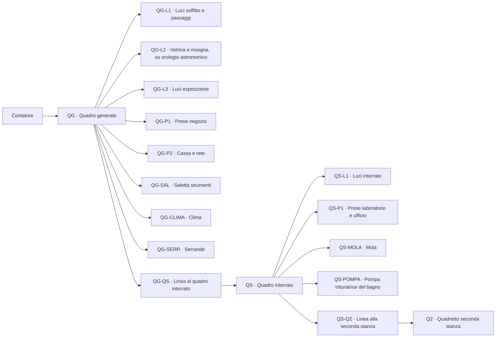

# Schema elettrico — Limpidia

Revisione IE01 del 2026-11-26. File generato da `impianto/impianto.json` con `python -m impianto.schema`: non si modifica a mano. PRELIMINARE - NON PER CANTIERE: taglie, sezioni e tipi delle protezioni li decide il progetto dell'impresa.

## Fornitura

- Contatore: Unareti monofase, Gridspertise GEMIS OM.510 (2022), 230 V, fino a 60 A (rilevato).
- Posizione: interrato, prima stanza, armadietto.
- Potenza del contratto: da leggere in bolletta.
- A valle del contatore: magnetotermico CHINT DZ47s-63 C63 su tre moduli: da verificare rispetto alla sezione del montante.

## Albero dei quadri

## Quadri

| Quadro | Piano | Posizione | Alimentato da | Dotazioni | Stato |
| --- | --- | --- | --- | --- | --- |
| QG Quadro generale | terra | piano terra, raggiungibile da chi è in negozio (proposta, decisione aperta) | contatore (montante) | interruttore generale; limitatore di sovratensioni | progetto |
| QS Quadro interrato | interrato | prima stanza, vicino al contatore (proposta) | QG | — | progetto |
| Q2 Quadretto seconda stanza | interrato | seconda stanza | da verificare | BTicino Salvavita GC8813AC10: magnetotermico differenziale C10, 30 mA, tipo AC | esistente |

## Circuiti e utenze

### QG-L1 — Luci soffitto e passaggi

Quadro QG, differenziale 1, stato: progetto.

| Utenza | Piano | Tipo | Punti | Punto nel modello | Stato | Note |
| --- | --- | --- | --- | --- | --- | --- |
| U-SCALA Scala: LED gradini | terra | luce | 1 alimentazione | E07 (da definire) | progetto | — |
| U-SALETTA-LUCE Saletta: luce | terra | luce | 1 punto luce + 1 comando | — | progetto | sul gruppo luci: se scatta uno strumento la stanza non resta al buio |
| U-SOFFITTO Binari a soffitto | terra | luce | 3 alimentazioni + 2 comandi | E09 (soffitto) | progetto | — |
| U-EMERGENZA-PT Luci di emergenza autonome, piano terra | terra | luce | 4-5 lampade | — | progetto | numero e posizione dal progetto |

### QG-L2 — Vetrina e insegna, su orologio astronomico

Quadro QG, differenziale 1, stato: progetto.

| Utenza | Piano | Tipo | Punti | Punto nel modello | Stato | Note |
| --- | --- | --- | --- | --- | --- | --- |
| U-VETRINA Vetrina e insegna | terra | luce | 2 punti | — | progetto | — |

### QG-L3 — Luci esposizione

Quadro QG, differenziale 2, stato: progetto.

| Utenza | Piano | Tipo | Punti | Punto nel modello | Stato | Note |
| --- | --- | --- | --- | --- | --- | --- |
| U-C1 C1 e mensole della parete di fondo | terra | luce | 1 alimentazione LED | E02 (parete di fondo) | progetto | — |
| U-C2 C2, fronte saletta | terra | luce | 1 alimentazione LED | E03A (tramezzo saletta W_SAL_S1, lato negozio) | progetto | — |
| U-C3 C3, fronte saletta | terra | luce | 1 alimentazione LED | E03B (tramezzo saletta W_SAL_S1, lato negozio) | progetto | — |
| U-C4 C4, parete laterale | terra | luce | 1 alimentazione LED | E03C (parete laterale destra) | progetto | — |
| U-SMART Parete smart, quattro telai | terra | luce | 1-2 alimentazioni | E04 (tramezzo W_SAL_O, lato scala, sotto il rivestimento) | progetto | — |

### QG-P1 — Prese negozio

Quadro QG, differenziale 2, stato: progetto.

| Utenza | Piano | Tipo | Punti | Punto nel modello | Stato | Note |
| --- | --- | --- | --- | --- | --- | --- |
| U-ISOLA Isola smart: ricarica e luce | terra | energia | 1 presa | E05 (pavimento sotto l'isola oppure parapetto: da decidere) | da decidere | collegamento A/B/C da decidere |
| U-SCRIVANIA Scrivania consulenza | terra | energia+dati | 2 prese + 1 dati | E06 (pavimento sotto la scrivania oppure parete C4: da decidere) | da decidere | collegamento A/B da decidere |
| U-PRESE-PT Prese di servizio, piano terra | terra | energia | 4 prese | — | progetto | — |
| U-MONITOR Monitor (vetrina, parete smart, cassa) | terra | predisposizione | presa + dati dietro ogni monitor | — | futuro | posizioni da decidere prima di chiudere le pareti |

### QG-P2 — Cassa e rete

Quadro QG, differenziale 3, stato: progetto.

| Utenza | Piano | Tipo | Punti | Punto nel modello | Stato | Note |
| --- | --- | --- | --- | --- | --- | --- |
| U-CASSA Cassa: POS, monitor/PC, stampante | terra | energia+dati | 3 prese + 1 dati | E01 (parete sinistra dietro il fianco cassa) | progetto | — |

### QG-SAL — Saletta strumenti

Quadro QG, dedicato, stato: progetto.

| Utenza | Piano | Tipo | Punti | Punto nel modello | Stato | Note |
| --- | --- | --- | --- | --- | --- | --- |
| U-SALETTA Saletta: strumenti di refrazione | terra | energia+dati | 4 prese + 1 dati | E08 (da definire dentro la saletta) | progetto | elenco strumenti e potenze da Sherin |

### QG-CLIMA — Clima

Quadro QG, dedicato, stato: da decidere.

| Utenza | Piano | Tipo | Punti | Punto nel modello | Stato | Note |
| --- | --- | --- | --- | --- | --- | --- |
| U-CLIMA Climatizzatore | terra | energia | 1 linea + collegamento all'unità esterna | — | da decidere | macchina da scegliere; foro del vecchio Delchi sopra la porta da chiudere o riusare |

### QG-SERR — Serrande

Quadro QG, dedicato, stato: progetto.

| Utenza | Piano | Tipo | Punti | Punto nel modello | Stato | Note |
| --- | --- | --- | --- | --- | --- | --- |
| U-SERRANDE Serrande motorizzate | terra | energia | 2 motori con comandi | — | esistente | funzionano: si tengono motori e comandi |

### QG-QS — Linea al quadro interrato

Quadro QG, linea, stato: progetto. Alimenta QS.

### QS-L1 — Luci interrato

Quadro QS, differenziale, stato: progetto.

| Utenza | Piano | Tipo | Punti | Punto nel modello | Stato | Note |
| --- | --- | --- | --- | --- | --- | --- |
| U-LUCI-INT Luci prima stanza | interrato | luce | 2-3 punti + 1 comando | — | progetto | luce forte sopra il banco |
| U-ASPIRATORE Aspiratore della stanza | interrato | energia | 1 punto | — | da decidere | tenere il Vortice esistente o sostituirlo (F12) |
| U-BAGNO Bagno: luce e aspiratore | interrato | luce | 1 luce + 1 aspiratore | — | progetto | — |
| U-SCALA-INT Luci della scala, lato interrato | interrato | luce | 1-2 punti + comandi in cima e in fondo | — | progetto | — |

### QS-P1 — Prese laboratorio e ufficio

Quadro QS, differenziale, stato: progetto.

| Utenza | Piano | Tipo | Punti | Punto nel modello | Stato | Note |
| --- | --- | --- | --- | --- | --- | --- |
| U-BANCO Banco laboratorio montaggio e smart | interrato | energia | 6 prese a quota banco | — | progetto | — |
| U-SCRIVANIA-RAY Scrivania di Ray | interrato | energia+dati | 4 prese + 2 dati | — | progetto | — |
| U-ROUTER Angolo fibra e router | interrato | energia+dati | 2 prese | — | progetto | si tiene la terminazione della fibra (F14) |

### QS-MOLA — Mola

Quadro QS, dedicato, stato: progetto.

| Utenza | Piano | Tipo | Punti | Punto nel modello | Stato | Note |
| --- | --- | --- | --- | --- | --- | --- |
| U-MOLA Mola | interrato | energia | 1 presa | — | progetto | potenza, acqua e scarico dalla scheda della macchina |

### QS-POMPA — Pompa trituratrice del bagno

Quadro QS, dedicato, stato: progetto.

| Utenza | Piano | Tipo | Punti | Punto nel modello | Stato | Note |
| --- | --- | --- | --- | --- | --- | --- |
| U-POMPA Pompa trituratrice del WC | interrato | energia | 1 presa | — | progetto | deve restare sempre alimentata (F11) |

### QS-Q2 — Linea alla seconda stanza

Quadro QS, linea, stato: da decidere. Alimenta Q2. solo se il quadretto Q2 è alimentato dal nostro impianto.

| Utenza | Piano | Tipo | Punti | Punto nel modello | Stato | Note |
| --- | --- | --- | --- | --- | --- | --- |
| U-STANZA2 Seconda stanza: impianto a vista esistente | interrato | energia | invariati | — | esistente | si lascia com'è (F15-F17) |

## Rete dati e predisposizioni senza circuito

| Utenza | Piano | Tipo | Punti | Stato | Note |
| --- | --- | --- | --- | --- | --- |
| U-WIFI-PT Access point Wi-Fi, piano terra | terra | dati | 1 dati (PoE) | progetto | — |
| U-DORSALE-DATI Cavo di rete dal router al piano terra | interrato | dati | 1 cavo Cat 6 tra i piani | progetto | nei tubi tra i piani, separato dai cavi di energia |
| U-TELECAMERE Telecamere | terra | predisposizione | tubi vuoti verso ingresso, cassa e laboratorio | futuro | telecamere di rete alimentate dal cavo dati (PoE): basta un tubo vuoto fino al router |
| U-AUDIO Casse audio | terra | predisposizione | tubi vuoti verso 2-4 posizioni a soffitto | futuro | — |

## Stato di fatto

| Foto | Piano | Cosa c'è | Destino |
| --- | --- | --- | --- |
| [F01](foto/F01.jpg) | terra | Quadretto a incasso: generale ABB bipolare (OFF) e due magnetotermici differenziali ABB, SOPRA e SOTTO; sotto, pulsantiera luci del vecchio negozio e placca blu con pulsante e presa | sostituito dal QG; dalla pulsantiera si tengono solo i comandi delle serrande |
| [F02](foto/F02.jpg) | terra | Condizionatore Delchi monoblocco sopra la porta, cavo a vista | tolto; foro da chiudere o riusare |
| [F03](foto/F03.jpg) | terra | Pilastro vicino alla vetrina: orologio Flash, timer del riscaldamento su guida DIN, cavi sciolti, zona scura dove c'era un pannello | tolto tutto; comando del riscaldamento da rifare; zona scura da controllare |
| [F04](foto/F04.jpg) | terra | Sopra la vetrina: cavi con morsetti volanti e scatola di derivazione aperta | tolti |
| [F05](foto/F05.jpg) | terra | Scatola grigia sul cornicione con simbolo di sirena | da identificare e togliere |
| [F06](foto/F06.jpg) | terra | Comandi e presa vecchi, presa telefono/dati a battiscopa | tolti; scatole riusate dove servono |
| [F07](foto/F07.jpg) | terra | Faretto a parete, placche basse senza frutti, macchie sul muro | tolti; umidità da verificare |
| [F08](foto/F08.jpg) | interrato | Contatore Unareti monofase e magnetotermico CHINT C63 | il contatore resta; protezione del montante da verificare |
| [F09](foto/F09.jpg) | interrato | Pianerottolo scala: comandi SCR, VENT, MAG e prese a battiscopa | tolti |
| [F10](foto/F10.jpg) | interrato | Sotto la scala: prese esterne vecchie, presa telefonica a tre poli, scatola aperta; umidità di risalita | tolti; prese nuove più in alto |
| [F11](foto/F11.jpg) | interrato | Bagno con pompa trituratrice, comandi fuori dalla porta, presa bassa vicino a muffa | pompa su linea dedicata; luce e aspiratore rifatti |
| [F12](foto/F12.jpg) | interrato | Aspiratore Vortice a parete con comando e presa | da decidere |
| [F13](foto/F13.jpg) | interrato | Canalina esterna con multipresa tripla e presa; bocchetta di ventilazione | tolti |
| [F14](foto/F14.jpg) | interrato | Terminazione della fibra, centralino telefonico Promelit, prese telefoniche vecchie | la fibra resta; centralino da decidere |
| [F15](foto/F15.jpg) | interrato | Seconda stanza: quadretto con BTicino GC8813AC10 (C10, 30 mA, tipo AC) | resta; alimentazione da verificare |
| [F16](foto/F16.jpg) | interrato | Seconda stanza: tubi rigidi a vista e scatola di derivazione sopra la porta, comando doppio | resta |
| [F17](foto/F17.jpg) | interrato | Seconda stanza: fari LED a parete, presa e comandi in scatole esterne | resta |
